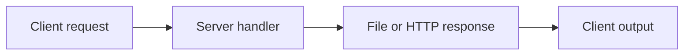

# FTP and HTTP Network Programming

### Client/server protocol exercises in Python and Java.

**Python · Java · Sockets · HTTP · FTP exercises**

*Archived coursework / research prototype · Not actively maintained*

A collection of networking exercises covering file-transfer and HTTP-style client/server communication. Python and Java variants are kept with their original source filenames.

## What is included

- File request and transfer examples
- HTTP client/server exercises
- Separate Java FTP client and server variants

The repository includes 8 directly browsable source/notebook files and a [source archive](source.zip) containing 8 files with their package structure preserved. See [SOURCE_INDEX.md](SOURCE_INDEX.md) for its contents. Reference components retain their labels and upstream notices.

## Workflow

*Diagram reconstructed from the recovered source or project description.*

## Explore / run

Inspect host, port, and file-path constants before running. Start the matching server and client from the same language/variant in a local development environment. The exercises are not a hardened public network service.

### Direct source files

- [client_ftp.py](client_ftp.py)
- [http_client.py](http_client.py)
- [http_server.py](http_server.py)
- [server_ftp.py](server_ftp.py)
- [client_htttp.py](client_htttp.py)
- [FTPClient.java](FTPClient.java)
- [FTPServer.java](FTPServer.java)
- [server_http.py](server_http.py)

## Project status

No servers were started or exposed during publication. The original assignment variants may use simplified protocol behavior and should not be described as fully compliant FTP implementations without testing.

No training, benchmark, paid API request, or external service deployment was performed to prepare this showcase. Team names, student IDs, raw personal documents, and embedded credentials are excluded from the public upload copies. Additional scope notes are in [SOURCE_NOTES.md](SOURCE_NOTES.md).
